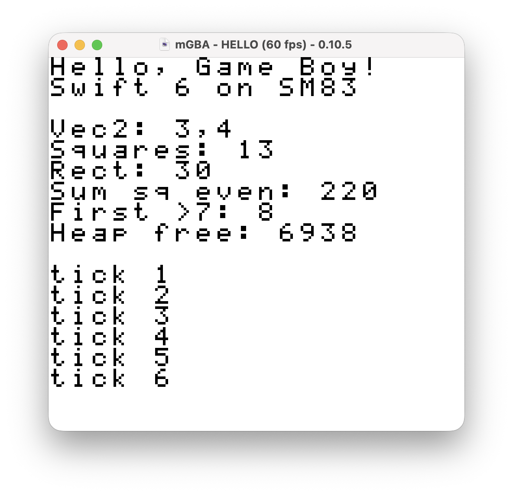

# swift-gameboy — Swift for the Game Boy

A Swift toolchain for the original Game Boy. The SM83 (Game Boy CPU) backend from
[llvm-z80](https://github.com/llvm-z80/llvm-z80) is integrated into the Swift compiler and exposed to SwiftPM
as the Swift SDK `gameboy`. Programs written in Embedded Swift are turned into Game Boy ROMs (`.gb`) with
`swift package gb-rom`.

<p align="center">

</p>

```swift
import GameBoy

Console.initialize()
print("Hello, Game Boy!")
let squares = [1, 2, 3, 4].map { $0 * $0 }
print(squares.reduce(0, +))     // 30
while true { Display.waitVBlank() }
```

## Requirements

- Swift 6.4 on macOS (Apple Silicon, Xcode 27) or Linux (x86_64 / aarch64, e.g. the `swift:6.4.2` Docker image)
- The Swift SDK `gameboy` (see below)

## Usage

Install the prebuilt Swift SDK from the [Releases](https://github.com/trickart/swift-gameboy/releases) page. Each
release contains one bundle for all supported hosts; SwiftPM picks the right toolchain for your machine:

```sh
swift sdk install https://github.com/trickart/swift-gameboy/releases/download/0.0.1/swift-gameboy-0.0.1.artifactbundle.tar.gz \
  --checksum 40d78a8a14d16f2ef5de47c825d80c199622dd1d606c00067b5fa699d5fe087d
swift sdk list   # → gameboy
```

The checksum of each release is in its `.sha256` file and release notes. To build the toolchain from source
instead, run `./setup.sh` (1.5–3 hours; see [toolchain/README.md](toolchain/README.md)).

Then add the `GameBoy` library to your package:

```swift
// swift-tools-version:5.9
import PackageDescription

let package = Package(
    name: "mygame",
    dependencies: [
        .package(url: "https://github.com/trickart/swift-gameboy.git", branch: "main"),
    ],
    targets: [
        .executableTarget(name: "mygame", dependencies: [.product(name: "GameBoy", package: "swift-gameboy")]),
    ]
)
```

```sh
swift package --swift-sdk gameboy --build-system native gb-rom -c release
# → .build/plugins/GBRom/outputs/mygame.gb
python3 tools/sm83emu.py .build/plugins/GBRom/outputs/mygame.gb --ascii   # bundled headless emulator
```

`--build-system native` is required (the default build system does not support bare-metal linking yet).
`gb-rom` accepts `-c release|debug`, `--product <name>`, `--title <string>` and `-o <path>` (writing inside the
package directory needs `--allow-writing-to-package-directory`). The `objc[...]` and `libSwiftScan` warnings
printed during the build are harmless.
The resulting ROM is 32KB with no MBC and runs on real hardware and in emulators (SameBoy, mGBA, BGB).
See `examples/hello` and `examples/sprite` for sample programs.

## The GameBoy module

| Type | Contents |
|---|---|
| `HW` | I/O registers (`HW.lcdc`, `HW.ly`, `HW.scx`, …) and pointers to VRAM/OAM (volatile) |
| `Display` | `waitVBlank()`, `turnOff()`/`turnOn()`, `configure([...])`, `loadTiles`, `setBackgroundTile(x:y:_:)`, `fillBackground`, palettes, scrolling |
| `Console` | 20×18 character text console; `print` writes here |
| `Serial` | Serial port output (`print` goes to both the screen and the serial port) |
| `Joypad` | `poll()`, then `held` / `pressed` / `released` |
| `Sprites` | Shadow OAM: `set(_:x:y:tile:attributes:)`, `hide`, `flush()` during VBlank |
| `Interrupts` | `enable([.vblank])`; handlers are defined as `@_cdecl("gb_vblank_handler") func ...()` |
| `Sound` / `Random` / `Font` / `Memory.heapFree` | Beep, 16-bit xorshift, 5×7 font, free heap |

## Limitations

- The ROM is 32KB and `Int` is 16 bits. Swift code is large, so everything is built with `-Osize`. Rough sizes:
  hello 9.4KB, sprite 7.5KB, `sorted()` about 14KB, `Double` arithmetic about 18KB. `String`, string interpolation,
  `Dictionary`/`Set` and `print(Float)` do not fit in 32KB. Use `StaticString` for text and `print(value)` for numbers.
- The usual Embedded Swift restrictions apply (`Any`, reflection, `async`, …). MBC (bank switching) is not supported.
- Do not perform reference-counting operations in interrupt handlers. Write to VRAM through the `Display` API while the LCD is on.
- The bundled emulator is a simple one for testing; verify on SameBoy or similar before release.

## Layout

```
Sources/GameBoy/   GameBoy module                 Plugins/GBRom/   gb-rom plugin (build + ELF → .gb)
examples/          sample programs                tests/features/  language feature test
runtime/           crt0, linker script and C runtime (installed into the toolchain)
toolchain/         toolchain build scripts, SM83 patches, Swift SDK generation
tools/             emulator (sm83emu.py), regression tests (test.sh), font generator
```

## License

Apache License 2.0 ([LICENSE](LICENSE)). Code derived from LLVM, llvm-z80 and Swift in `runtime/compiler-rt/`
and `toolchain/patches/` is covered by Apache-2.0 WITH LLVM-exception and Apache-2.0 with Runtime Library
Exception respectively.
